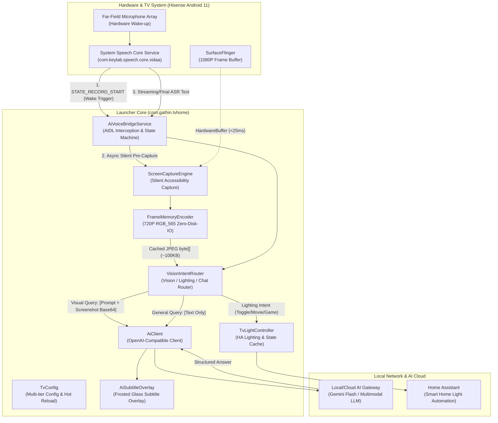

# Vidda AI Launcher

**English** | [中文文档](README.zh-CN.md)

> 📌 **Origins & Attribution**  
> This project is built upon and extended from [Gathin23/cleanyourtv](https://github.com/Gathin23/cleanyourtv).  
> While the upstream project delivers a clean, ad-free tvOS-style launcher for Android TV / Google TV, this project deeply integrates with **Hisense Vidda / VIDAA TV hardware** to build a comprehensive smart home and multimodal AI center. It introduces **local multimodal AI vision understanding, zero-permission silent screen capture, deep system-level hardware speech bridge interception, Home Assistant ambient lighting automation, and zero-downtime hot-reloading configurations**.

---

## Table of Contents
- [1. System Architecture & Data Flow](#1-system-architecture--data-flow)
- [2. Architecture Modules](#2-architecture-modules)
  - [2.1 Minimalist Desktop Launcher (Launcher UI)](#21-minimalist-desktop-launcher-launcher-ui)
  - [2.2 Multimodal AI Client (AiClient)](#22-multimodal-ai-client-aiclient)
  - [2.3 Silent Screen Perception Engine (ScreenCaptureEngine)](#23-silent-screen-perception-engine-screencaptureengine)
  - [2.4 Deep Hardware Speech Bridge (AiVoiceBridgeService)](#24-deep-hardware-speech-bridge-aivoicebridgeservice)
  - [2.5 Smart Home Ambient Lighting (TvLightController)](#25-smart-home-ambient-lighting-tvlightcontroller)
  - [2.6 Unified Decoupled Configuration Center (TvConfig)](#26-unified-decoupled-configuration-center-tvconfig)
- [3. Implementation Principles](#3-implementation-principles)
  - [3.1 Wake-Up Asynchronous Pre-Capture (0 ms Perceived Latency)](#31-wake-up-asynchronous-pre-capture-0-ms-perceived-latency)
  - [3.2 Zero-Disk-IO High-Performance Memory Encoding](#32-zero-disk-io-high-performance-memory-encoding)
  - [3.3 Far-Field Microphone Array Time-Slice Replenishment](#33-far-field-microphone-array-time-slice-replenishment)
  - [3.4 Low-Level AIDL Interception & Speech Lifecycle Management](#34-low-level-aidl-interception--speech-lifecycle-management)
  - [3.5 Multi-Tier Failover & Self-Healing Communication](#35-multi-tier-failover--self-healing-communication)
  - [3.6 Pre-Flight State Verification & Idempotent Light Control](#36-pre-flight-state-verification--idempotent-light-control)
- [4. Setup & Deployment](#4-setup--deployment)
  - [4.1 Configuration File (tvhome_config.json)](#41-configuration-file-tvhome_configjson)
  - [4.2 One-Click Build & Deploy (deploy.sh)](#42-one-click-build--deploy-deploysh)
- [5. License & Credits](#5-license--credits)

---

## 1. System Architecture & Data Flow



---

## 2. Architecture Modules

### 2.1 Minimalist Desktop Launcher (Launcher UI)
- **Apple TV / tvOS Aesthetic**: Pitch-black backdrop, rounded frosted-glass Dock bar holding primary streaming applications, and a slide-up full application grid.
- **Physical Spring Focus Animation (`SpringAnimation`)**: A single rounded glass highlight springs smoothly between tiles, eliminating the rigid, flickering borders common in generic TV launchers.
- **Dynamic Ambient Color Extraction (`ambientColorAt`)**: Samples the vivid dominant color from the focused application's banner/icon, smoothly projecting a matching ambient glow behind the title shelf.
- **Anti-Burn-In Clock Screensaver (`ClockDream`)**: Designed for OLED and large TVs; a minimalist thin font drifts gently across the screen to prevent static pixel retention.
- **Dynamic Network Pill**: Real-time detection and display of Wi-Fi SSID and Ethernet status with direct navigation to system settings.

### 2.2 Multimodal AI Client (`AiClient`)
- **OpenAI-Compatible Communication**: Connects directly to local forwarders or cloud AI gateways, optimized for Gemini 3.8 Flash and similar vision models.
- **Intelligent Multi-Tier Failover**: Automatically cascades through candidates: verified working URL → Global Settings → LAN Gateway → Local Loopback (`127.0.0.1:3425`).
- **Request Generation ID (`sRequestIdGenerator`)**: Drops stale in-flight responses immediately when users re-wake or interrupt, avoiding cross-talk or outdated spoken output.
- **Pure TTS Output Sanitization**: High-performance pre-compiled regex filters strip Markdown markers (`#`, `*`, code blocks, lists) and emoji symbols before passing text to the TV's TTS voice engine.
- **Lightweight Multi-Turn Memory**: Implements a "current-turn image, history text-only" pattern, shedding large Base64 image payloads from past rounds to keep total context size under 4 KB.

### 2.3 Silent Screen Perception Engine (`ScreenCaptureEngine`)
- **Zero-Permission Silent Capture**: Employs Android's `AccessibilityService.takeScreenshot` pipeline, bypassing root requirements and intrusive OS confirmation dialogs.
- **Wake-Moment Asynchronous Pre-Capture**: Captures the frame the exact moment the wake word is detected; frame compression finishes while the user is still speaking, yielding **0 ms perceived latency**.
- **Zero-Disk-IO Memory Encoder (`FrameMemoryEncoder`)**: Scales raw 1080P ARGB_8888 buffers down to 720P RGB_565 and compresses them into a reusable in-memory JPEG stream without ever writing to TV flash storage.

### 2.4 Deep Hardware Speech Bridge (`AiVoiceBridgeService`)
- **Hisense Speech Core AIDL Binding**: Binds directly to `com.keylab.speech.core.vidaa`, listening to speech lifecycle events (`STATE_RECORD_START`, `STATE_RECORD_END`, `STATE_SPEAK_END`, etc.).
- **Hardware Wake-Word Synchronization**: Automatically manages system properties and broadcasts to keep `"你好小智"` and `"海信小智"` active across TV reboots.
- **Continuous Conversation Time-Slice Replenishment**: Bypasses the TV's built-in 5-second microphone silence timeout to maintain open listening throughout a configurable user reflection window (e.g., 25 seconds).
- **Audio Focus Management**: Transiently pauses background video and music during voice interactions, automatically resuming playback once speech ends.
- **Frosted Glass Floating Subtitle (`AiSubtitleOverlay`)**: Displays real-time wave animations, recognition transcripts, and AI responses with tap/key dismissal support.

### 2.5 Smart Home Ambient Lighting (`TvLightController`)
- **Home Assistant Webhook Integration**: Supports toggle (`tv_light_toggle`), status query (`tv_light_status`), movie mode (`tv_light_movie`), and game mode (`tv_light_game`).
- **Pre-Flight State Verification & Idempotency**: Inspects real-time light status before toggling. Saying "turn off light" while it is already off results in a polite voice confirmation without sending a redundant toggle request.
- **ASR & Semantic Intent Debouncing**: 3-second debounce window prevents dual triggering from parallel ASR streaming results and semantic intent callbacks.

### 2.6 Unified Decoupled Configuration Center (`TvConfig`)
- **Zero Hardcoded Secrets**: Extracts all API keys, local IPs, Home Assistant webhooks, prompts, and timeout thresholds into an external JSON configuration file.
- **Tiered Lookup Hierarchy**: Application private storage (`files/`) → External storage (`/sdcard/`) → Temp directory (`/data/local/tmp/`) → Bundled Assets → System Properties → Safe fallbacks.
- **Zero-Downtime Hot Reloading**: Timestamp monitoring reloads modified configurations immediately without restarting the launcher application.

---

## 3. Implementation Principles

### 3.1 Wake-Up Asynchronous Pre-Capture (0 ms Perceived Latency)
Traditional screen analysis triggers capture after speech recognition finishes (`onResults`). This introduces two major problems:
1. The voice UI overlay is already visible, occluding the content the user is asking about;
2. Capturing, scaling, and compressing takes 300 ms ~ 800 ms, directly increasing response wait times.

**This project implements Wake-Moment Asynchronous Pre-Capture**:
1. When the user says the wake word, the hardware microphone array fires `STATE_RECORD_START`;
2. Within **`< 5 ms`** (before any UI is rendered), a worker thread triggers `takeScreenshot`;
3. The user typically speaks for 1.5 to 4 seconds. During this window, frame capture, matrix downsampling, and JPEG compression complete in **`< 45 ms`**;
4. When `onResults` arrives, the compressed frame is already resident in memory, achieving **0 ms perception latency**.

### 3.2 Zero-Disk-IO High-Performance Memory Encoding
Smart TVs frequently utilize budget flash storage that degrades under heavy write cycles. `FrameMemoryEncoder` solves this:
- **Matrix Downsampling**: Raw 1080P ARGB_8888 frames consume **`8.29 MB`**. Upon receiving the `HardwareBuffer`, the encoder uses a hardware matrix to downscale directly to **`1280×720 RGB_565`**, dropping memory to **`1.84 MB`**. The original buffer is recycled in under 15 ms.
- **Reusable Byte Buffers**: A fixed `ReusableByteArrayOutputStream` compresses the bitmap to a 75-quality JPEG stream (yielding **70 KB ~ 130 KB**). Zero temporary files are written to disk.

### 3.3 Far-Field Microphone Array Time-Slice Replenishment
Hisense hardware firmware terminates microphone listening if 5 seconds of silence occur (throwing error code `109` or `10114`).
- `AiVoiceBridgeService` tracks a conversational deadline (`mListenDeadlineMs`, default 25 seconds);
- When a silence timeout occurs before the deadline, the service absorbs the error and restarts listening within 200 ms;
- This allows natural pauses while users formulate multi-turn follow-up questions.

### 3.4 Low-Level AIDL Interception & Speech Lifecycle Management
- Direct AIDL binding to `com.keylab.speech.core.vidaa.CoreService`:
  ```java
  Intent intent = new Intent("com.keylab.speech.core.vidaa.CoreService");
  intent.setPackage("com.keylab.speech.core.vidaa");
  bindService(intent, mServiceConnection, Context.BIND_AUTO_CREATE);
  ```
- An `ICoreListener` implementation intercepts speech states, streaming ASR text, and TTS synthesis, completely replacing the vendor's stock advertising voice assistant.

### 3.5 Multi-Tier Failover & Self-Healing Communication
`AiClient` maintains a resilient failover sequence:
1. **Last Working URL**: Prioritizes the most recently validated endpoint;
2. **Global Setting**: Queries `Settings.Global.tvhome_ai_url`;
3. **Configured LAN Gateway**: Reads `gateway.lan_url` from `tvhome_config.json`;
4. **Local Loopback**: Falls back to `http://127.0.0.1:3425/v1` (via ADB reverse proxy).
With a 3-second connection timeout, network interruptions smoothly transition to alternative routes without crashing the app.

### 3.6 Pre-Flight State Verification & Idempotent Light Control
Blind webhook toggling easily leads to state inversion during latency spikes or accidental double-invocations.
- `TvLightController` executes a synchronous GET check against `tv_light_status`;
- If the current state matches the desired state, the request short-circuits with a voice confirmation;
- Toggle webhooks are only dispatched when state mismatch is verified.

---

## 4. Setup & Deployment

### 4.1 Configuration File (`tvhome_config.json`)
All sensitive credentials and private addresses are excluded from version control. Copy the template and fill in your settings:
```bash
cp tvhome_config.example.json tvhome_config.json
```

Example structure:
```json
{
  "gateway": {
    "lan_url": "http://192.168.1.100:3425/v1",
    "local_url": "http://127.0.0.1:3425/v1",
    "api_key": "sk-your-ai-gateway-api-key",
    "model": "google/models/gemini-3.8-flash"
  },
  "light": {
    "base_url": "http://192.168.1.101/api/webhook",
    "toggle_url": "http://192.168.1.101/api/webhook/tv_light_toggle",
    "status_url": "http://192.168.1.101/api/webhook/tv_light_status",
    "movie_url": "http://192.168.1.101/api/webhook/tv_light_movie",
    "game_url": "http://192.168.1.101/api/webhook/tv_light_game"
  },
  "prompt": {
    "system": "Interactive rules for the TV visual assistant..."
  },
  "conversation": {
    "session_expire_seconds": 600,
    "listen_timeout_seconds": 25
  }
}
```

### 4.2 One-Click Build & Deploy (`deploy.sh`)
The deployment script automates Gradle compilation, port reverse tunnels, APK installation, permission grants, and configuration synchronization:
```bash
# Usage: ./deploy.sh <YOUR_TV_IP>
./deploy.sh <YOUR_TV_IP>
```

---

## 5. License & Credits

- Licensed under the **MIT License**.
- The [Outfit](https://fonts.google.com/specimen/Outfit) typeface is licensed under the SIL Open Font License 1.1.
- Special thanks to [Gathin23/cleanyourtv](https://github.com/Gathin23/cleanyourtv) for the original launcher foundation and system debloat research.
