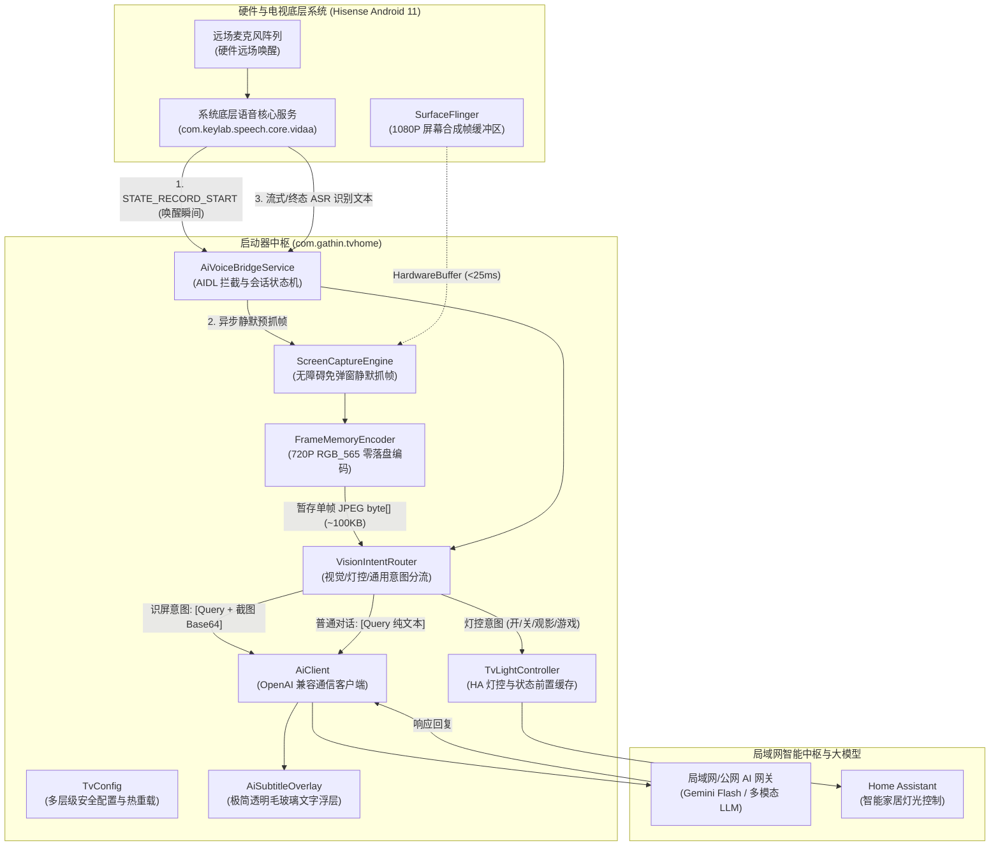

# Vidda AI Launcher (海信 Vidda TV AI 智能启动器与语音中枢)

[English Documentation](README.md) | **中文文档**

> 📌 **项目渊源与致谢**  
> 本项目基于开源项目 [Gathin23/cleanyourtv](https://github.com/Gathin23/cleanyourtv) 深度扩展与演进。  
> 原项目为 Android TV / Google TV 提供了极致精简、无广告的 tvOS 风格桌面底座；在此基础上，本项目深入结合海信 Vidda / VIDAA 系列智能电视硬件与系统特性，全面扩展实现了**本地多模态 AI 视觉感知、系统级无障碍免授权静默截屏、海信底层硬件语音桥接拦截、Home Assistant 智能家居氛围光联动与多层安全配置热重载**，将电视桌面升级为家庭多模态智能中枢。

---

## 目录
- [一、系统整体架构与数据流](#一系统整体架构与数据流)
- [二、核心模块划分与功能特性](#二核心模块划分与功能特性)
  - [1. 桌面启动器与动效交互模块 (Launcher UI)](#1-桌面启动器与动效交互模块-launcher-ui)
  - [2. 多模态 AI 视觉与通信客户端 (AiClient)](#2-多模态-ai-视觉与通信客户端-aiclient)
  - [3. 无感屏幕内容识别与抓帧引擎 (ScreenCaptureEngine)](#3-无感屏幕内容识别与抓帧引擎-screencaptureengine)
  - [4. 底层硬件语音桥接中枢 (AiVoiceBridgeService)](#4-底层硬件语音桥接中枢-aivoicebridgeservice)
  - [5. 智能家居与环境氛围光联动 (TvLightController)](#5-智能家居与环境氛围光联动-tvlightcontroller)
  - [6. 全局统一配置管理器 (TvConfig)](#6-全局统一配置管理器-tvconfig)
- [三、核心技术实现原理](#三核心技术实现原理)
  - [1. 唤醒瞬间异步预抓帧原理（0毫秒感知延迟）](#1-唤醒瞬间异步预抓帧原理0毫秒感知延迟)
  - [2. 零磁盘 IO 高性能内存图像编码原理](#2-零磁盘-io-高性能内存图像编码原理)
  - [3. 硬件远场麦克风切片续航原理](#3-硬件远场麦克风切片续航原理)
  - [4. 海信底层 AIDL 深度拦截与生命周期托管原理](#4-海信底层-aidl-深度拦截与生命周期托管原理)
  - [5. 智能故障转移 (Failover) 与自愈通信原理](#5-智能故障转移-failover-与自愈通信原理)
  - [6. 状态前置查询与幂等灯控原理](#6-状态前置查询与幂等灯控原理)
- [四、配置与部署指南](#四配置与部署指南)
  - [1. 配置文件说明 (tvhome_config.json)](#1-配置文件说明-tvhome_configjson)
  - [2. 一键编译与部署 (deploy.sh)](#2-一键编译与部署-deploysh)
- [五、开源协议](#五开源协议)

---

## 一、系统整体架构与数据流



---

## 二、核心模块划分与功能特性

### 1. 桌面启动器与动效交互模块 (Launcher UI)
- **Apple TV / tvOS 极简美学**：纯黑深色背景，底部圆角半透明 Dock 栏收纳常用核心应用，上滑展开全应用抽屉。
- **物理弹簧焦点高光 (`SpringAnimation`)**：单一大圆角毛玻璃高光卡片在磁贴间以弹簧物理动力学平滑游走，摆脱低端电视生硬的静态边框跳动。
- **环境微光实时拾取 (`ambientColorAt`)**：获焦卡片时自动提取 Banner/图标的高饱和主色并写入缓存，在顶部形成柔和的环境背景氛围微光，过渡自然无卡顿。
- **防烧屏时钟屏保 (`ClockDream`)**：专为 OLED 与大屏电视设计，大字体细线时钟在屏幕内随机慢速浮动，彻底杜绝静态像素灼伤。
- **网络与状态胶囊**：桌面常驻网络状态药丸按钮，精准识别并展示 Wi-Fi SSID 与以太网连接状态，支持焦点直达系统网络设置。

### 2. 多模态 AI 视觉与通信客户端 (`AiClient`)
- **OpenAI 兼容协议通信**：专为电视语音与视觉交互调优，直连本地前置 AI 网关或公网兼容端点，支持 Gemini 3.8 Flash 等多模态视觉模型。
- **智能故障转移自愈 (Failover)**：内置动态地址候选池机制。连通失败时毫秒级自动切换下一个候选地址，断网抖动不崩溃。
- **请求世代号 (`sRequestIdGenerator`)**：针对快速连续提问、被打断或频繁唤醒场景，自动废弃所有飞行中的旧请求回调，杜绝串音与错乱应答。
- **纯净 TTS 语音净化**：内置预编译正则引擎，在返回电视 TTS 引擎播报及字幕渲染前，彻底过滤 Markdown 标记符号（`#`, `*`, 代码块, 列表）和 Emoji 符号，确保朗读自然清晰。
- **轻量连续记忆模型（当轮带图、历史留文）**：多轮对话中自动剥离历史图像节点，上下文历史体积始终控制在 4KB 以内，杜绝 Token 浪费与带宽堆积。

### 3. 无感屏幕内容识别与抓帧引擎 (`ScreenCaptureEngine`)
- **系统级静默抓帧**：基于 Android 无障碍服务底层通道 (`AccessibilityService.takeScreenshot`)，免 Root、免弹窗授权。
- **硬件级异步预抓帧**：在电视麦克风阵列被唤醒的瞬间触发预抓帧，在用户说话完毕前图像已在内存完成压缩，达成 0 毫秒首屏等待。
- **零磁盘 IO 编码器 (`FrameMemoryEncoder`)**：瞬时将 1080P ARGB_8888 缩放至 720P RGB_565 并压缩为 JPEG 字节流，全程完全在内存堆外缓冲池中运转，保护电视 Flash 寿命。

### 4. 底层硬件语音桥接中枢 (`AiVoiceBridgeService`)
- **海信官方语音底层 AIDL 深度拦截**：双向绑定 `com.keylab.speech.core.vidaa` 核心服务，接管全生命周期语音事件（唤醒、拾音、ASR 识别、TTS 播报）。
- **远场硬件双唤醒词守护**：自动同步下发系统设置项与广播，保证“你好小智”与“海信小智”物理麦克风阵列常态唤醒。
- **全双工切片续航机制**：克服海信底层硬件麦克风阵列 5~6 秒静音强行关闭的限制，在设定的思考等待期内无缝续听，支持用户从容追问。
- **音频焦点智能避让**：交互瞬间主动申请临时音频焦点（Transient Duck），自动压低或暂停后台正在播放的影视剧/音乐，对话结束后自动恢复。
- **透明浮层字幕交互 (`AiSubtitleOverlay`)**：无边框半透明毛玻璃浮层，实时呈现拾音波形指示、识别文字与 AI 回复，支持随时退出或被新指令打断。

### 5. 智能家居与环境氛围光联动 (`TvLightController`)
- **Home Assistant Webhook 联动**：深度集成开关切换 (`tv_light_toggle`)、状态实时查询 (`tv_light_status`)、观影模式 (`tv_light_movie`)、游戏模式 (`tv_light_game`)。
- **状态前置查询与幂等保护**：执行开关前主动查询 HA 实时灯光状态；当前若是开灯状态下发“开灯”指令，系统直接忽略并静默保持，杜绝双向 Toggle 导致的误关与频闪。
- **ASR 与语义双通道防抖**：设置 3 秒防抖保护窗，防止流式 ASR 和语义意图同时触发两次网络请求。

### 6. 全局统一配置管理器 (`TvConfig`)
- **敏感信息完全解耦**：将大模型网关地址、API Key、内网私有 IP、智能家居 Webhook、系统提示词与超时时间统一提取至独立配置文件。
- **分层查找优先级**：应用私有存储目录 (`files/`) → 外部公共存储 (`/sdcard/`) → 临时目录 (`/data/local/tmp/`) → APK 打包 Assets → 系统全局设置 → 代码安全默认值。
- **零停机动态热重载**：内置文件时间戳检测机制，无需杀死或重启桌面进程，更新配置文件即刻全量生效。

---

## 三、核心技术实现原理

### 1. 唤醒瞬间异步预抓帧原理（0毫秒感知延迟）
传统电视截屏方案多在用户语音识别结束（`onResults`）后调用，存在致命弊端：
1. 此时底部已弹出语音交互浮窗，截屏必然被浮层卡片大面积遮挡；
2. 截屏、格式转换和压缩时间（约 300ms ~ 800ms）全部叠加在网络请求前，造成严重卡顿感。

**本项目采用“唤醒瞬间预抓帧”时序机制**：
1. 当用户开口说出唤醒词时，底层麦克风硬件触发 `STATE_RECORD_START` 事件；
2. 服务在 UI 尚未开始渲染的第 **`< 5ms`**，立即在独立 Worker 线程发起 `takeScreenshot`；
3. 用户陈述提问通常持续 1.5 秒至 4 秒，而抓帧与内存压缩早在 **45ms** 内完成，单帧字节流静默常驻内存；
4. 当用户提问结束（`onResults`）到达时，图像数据早已就绪，立刻直传网关，实现 **0 毫秒感知延迟**。

### 2. 零磁盘 IO 高性能内存图像编码原理
海信电视搭载 MediaTek MT9653 SoC，物理内存较为有限且 Flash 写入损耗敏感。系统设计了极简高效的 `FrameMemoryEncoder`：
- **降采样降维**：屏幕原始合成帧为 `1920×1080 ARGB_8888`，内存占用高达 `8.29 MB`。抓帧返回 `HardwareBuffer` 后，利用硬件图形矩阵瞬间缩放至 **`1280×720 RGB_565`**（剔除无用 Alpha 通道），内存瞬间降至 **`1.84 MB`**。原始 Buffer 在 15ms 内立即 `recycle()` 与 `close()`，不占用系统显存。
- **固定复用字节流**：预分配固定容量的 `ReusableByteArrayOutputStream`，以 JPEG 质量 75 压缩至内存缓冲区（单帧压缩产物仅 **70 KB ~ 130 KB**），全程不产生任何临时文件，大幅提升读写性能并保护存储介质。

### 3. 硬件远场麦克风切片续航原理
电视系统自带的语音芯片对每次远场拾音设有硬件级超时阈值（通常在静音持续 5~6 秒时自动停止录音并触发 `STATE_RECORD_END` 或错误码 109/10114），这会导致用户在连续思考追问时麦克风突然被关闭。
- `AiVoiceBridgeService` 维护了会话超时截止时间戳 `mListenDeadlineMs`（默认 25 秒）；
- 在截止时间前，当底层抛出硬件切片停止或静音无输入超时时，服务会自动拦截并延时 200ms 重新调用 `startSpeechCoreListening()` 续期开听；
- 用户在 25 秒内任意时刻组织语言发问均能被无缝拾取，超时未发声则安全收回资源，完美平衡等待体验与硬件功耗。

### 4. 海信底层 AIDL 深度拦截与生命周期托管原理
- 通过 Android 标准 AIDL 接口与海信官方核心服务 `com.keylab.speech.core.vidaa` 建立长连接：
  ```java
  Intent intent = new Intent("com.keylab.speech.core.vidaa.CoreService");
  intent.setPackage("com.keylab.speech.core.vidaa");
  bindService(intent, mServiceConnection, Context.BIND_AUTO_CREATE);
  ```
- 注册 `ICoreListener` 深度监听底层录音切片、识别文本与 TTS 状态。用户表达完成后，由启动器自身发起 AI 网关调用并在浮层呈现，完全接管海信电视默认的广告化语音交互逻辑。

### 5. 智能故障转移 (Failover) 与自愈通信原理
`AiClient` 采用四级候选池机制保障高可用：
1. **优先复用地址**：记录最近一次成功响应的网关地址（如连通成功直接置顶）；
2. **全局动态地址**：读取 `Settings.Global.tvhome_ai_url`；
3. **配置文件 LAN 地址**：读取 `tvhome_config.json` 中的 `gateway.lan_url`；
4. **反向代理与本地回环**：读取 `http://127.0.0.1:3425/v1`（配合 ADB reverse 端口转发）。
单次请求设定 3 秒短连接超时，若首选网关不可达立刻平滑下切下一个地址，彻底杜绝网络波动导致的假死与闪退。

### 6. 状态前置查询与幂等灯控原理
针对家庭智能灯带控制，如果采用盲发 Toggle，一旦遇到语音识别延迟、网络重试或重复回调，极易出现“说了开灯反而把灯关了”的尴尬情况。
- 当识别到“开灯”或“关灯”意图时，控制器首先向 Home Assistant 的 `tv_light_status` 端点发起同步状态探测；
- 若灯具已经处于目标状态（例如已开状态下接收到“开灯”），立即短路返回，仅语音回复确认，不再发起网络 Toggle；
- 只有实际状态与期望状态不一致时才下发切换，并结合 3 秒防抖窗口，实现 100% 幂等操作。

---

## 四、配置与部署指南

### 1. 配置文件说明 (`tvhome_config.json`)
项目所有私有配置均抽离于代码之外。克隆代码后，在项目根目录根据模板创建私有配置文件：
```bash
cp tvhome_config.example.json tvhome_config.json
```
配置文件已在 `.gitignore` 中彻底排除，包含以下可配置字段：
```json
{
  "gateway": {
    "lan_url": "http://192.168.1.100:3425/v1",
    "local_url": "http://127.0.0.1:3425/v1",
    "api_key": "sk-your-ai-gateway-api-key",
    "model": "google/models/gemini-3.8-flash"
  },
  "light": {
    "base_url": "http://192.168.1.101/api/webhook",
    "toggle_url": "http://192.168.1.101/api/webhook/tv_light_toggle",
    "status_url": "http://192.168.1.101/api/webhook/tv_light_status",
    "movie_url": "http://192.168.1.101/api/webhook/tv_light_movie",
    "game_url": "http://192.168.1.101/api/webhook/tv_light_game"
  },
  "prompt": {
    "system": "请严格遵守以下交互与格式规则：\n1. 当附带图片时，该图片即为用户正在观看的电视屏幕画面，请自然直接地回答关于画面的问题..."
  },
  "conversation": {
    "session_expire_seconds": 600,
    "listen_timeout_seconds": 25
  }
}
```

### 2. 一键编译与部署 (`deploy.sh`)
运行部署脚本，脚本将自动完成 Gradle 编译、端口反向代理建立、APK 覆盖安装、权限授权及配置文件的无缝同步：
```bash
# 语法: ./deploy.sh <电视IP>
./deploy.sh <电视IP>
```

---

## 五、开源协议

本项目采用 **MIT License** 开源协议。  
字体资源 [Outfit](https://fonts.google.com/specimen/Outfit) 遵循 SIL Open Font License 1.1 协议。  
原启动器核心框架致谢开源项目 [cleanyourtv](https://github.com/Gathin23/cleanyourtv)。
